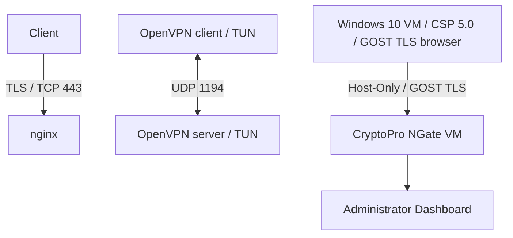

# Networking lab notes

A summary of learning work with GNS3, packet captures, and Python. This document is an independent overview, not an official assignment or a verified completion certificate.

## Areas represented in local materials

- ARP, IP addressing, and multicast packet inspection.
- DHCP, DNS, NTP, and SSH lab environments.
- VLAN, OSPF, EtherChannel, and HSRP topologies.
- Packet analysis and a Python networking exercise.

## Approach and architecture

The local lab materials use simulated network topologies, captured traffic, text observations, and a Python script. A useful lab workflow is to define an isolated topology, exercise a protocol, inspect the capture, and document observations. Successful outcomes have not yet been independently verified.

## Portfolio scope

This repository contains only this independently written summary. Original task statements, answers, topology files, device configurations, captures, internal addresses, and school materials are excluded. Publication rules for the original school work remain unconfirmed.

## Next improvements

Create an independent lab using synthetic addresses, document expected and observed traffic, and add reproducible setup instructions after validation.

## CbS10 — Data channel protection

Учебный проект Школы 21: защита каналов связи с помощью HTTPS, OpenVPN и CryptoPro NGate. Все четыре задания выполнены и отправлены в приватный GitLab, ветка `develop`. Подтверждение проверки Школой 21 пока не получено.

| Этап | Практическая работа | Результат |
| --- | --- | --- |
| HTTPS/TLS | nginx на TCP 443, Wireshark/tshark | Захвачен TLS-трафик, разобраны ClientHello и ServerHello |
| OpenVPN | Сервер и клиент, UDP 1194, Easy-RSA CA и сертификаты | Настроены TUN-интерфейсы, выполнен захват пакетов tcpdump |
| CryptoPro NGate | Отдельная VM, сертификаты, средства администрирования | Подготовлен лабораторный шлюз и административный доступ |
| Windows-клиент | Windows 10 VM, CryptoPro CSP 5.0, браузер с ГОСТ TLS | Выполнен вход в Dashboard NGate, результат зафиксирован в приватном отчёте |

### Архитектура

Это отдельные лабораторные сценарии; схема не означает, что HTTPS или OpenVPN работали через NGate.

### Практические навыки

- Настройка Linux-сервисов, адресация, TCP/UDP, виртуальные интерфейсы.
- HTTPS/TLS и анализ начала рукопожатия в Wireshark/tshark.
- OpenVPN, Easy-RSA, CA, сертификаты и захват трафика tcpdump.
- CryptoPro NGate, CSP 5.0, ГОСТ TLS и сертификатная аутентификация в учебном стенде.
- VirtualBox, Windows/Linux VM и Host-Only сети.
- Git/GitLab: оформление результатов, коммиты, push и проверка синхронизации ветки.

Опубликовано только самостоятельное описание практики. Приватный репозиторий, задания Школы 21, чужие материалы, ключи, сертификаты, пароли, конфигурации, захваты трафика и чувствительные скриншоты сюда не переносятся. Это учебная практика без заявления коммерческого опыта, производственной эксплуатации или независимого аудита.
